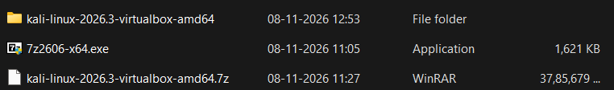
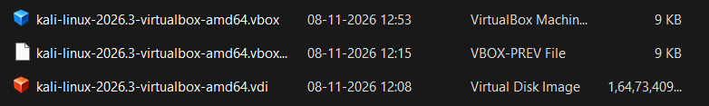
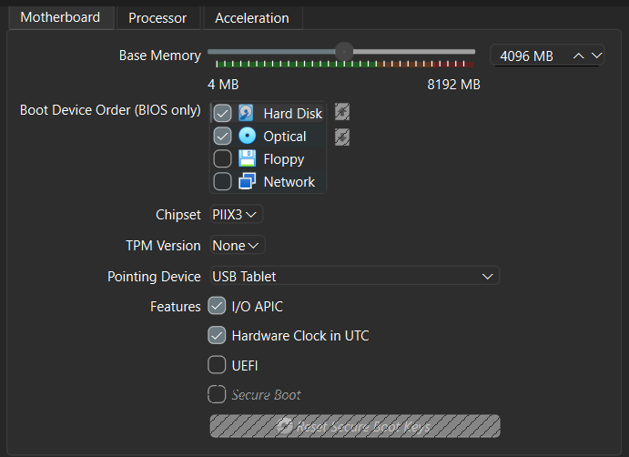
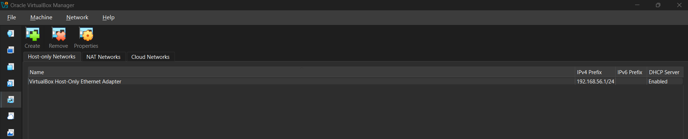
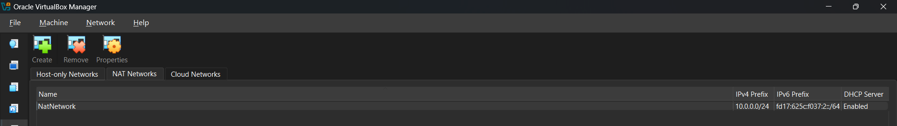
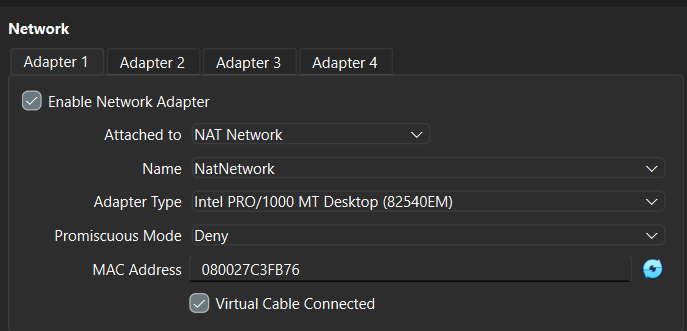
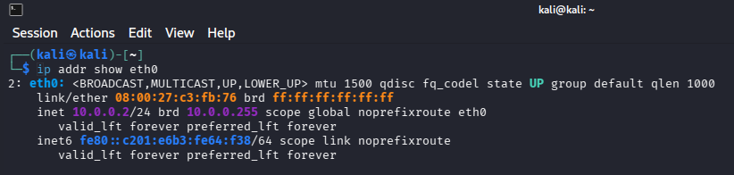
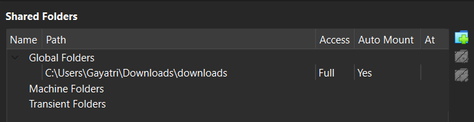

# NETWORKWALKS Cybersecurity Internship — Week 1

## Cybersecurity Lab Setup and Network Traffic Analysis

**Author:** Aditya Nambiar  
**Organization:** NETWORKWALKS  
**Program:** Cybersecurity Internship  
**Week:** 1  
**Project:** Lab Environment Setup and Traffic Analysis

---

## 1. Project Overview

During Week 1 of my cybersecurity internship at NETWORKWALKS, I set up a virtual cybersecurity lab and practised foundational networking and traffic-analysis tasks.

The lab uses Kali Linux running inside Oracle VirtualBox on a Windows host. I configured a NAT Network, assigned a static IP address to Kali, checked connectivity, and explored VirtualBox integration features. I also used Wireshark to capture and inspect network traffic.

This environment will serve as a foundation for upcoming cybersecurity exercises.

## 2. Project Task Checklist

| Task | Status |
|---|---|
| Install Oracle VirtualBox | Completed |
| Download and configure Kali Linux | Completed |
| Create and configure a NAT Network | Completed |
| Configure Kali's network interface and static IP | Completed |
| Verify network and internet connectivity | Completed |
| Enable shared clipboard and drag-and-drop | Completed |
| Configure a shared folder between Windows and Kali | Completed |
| Create a clean VM snapshot | Completed |
| Capture and analyse network traffic using Wireshark | Completed |
| Examine TCP SYN scanning activity and TCP stream communication | Completed |
| Inspect HTTP requests, plaintext credential exposure, and FTP authentication patterns | Completed |

## 3. Tools and Technologies

| Tool / Technology | Description |
|---|---|
| 7-Zip | Used to extract the Kali Linux archive |
| Oracle VirtualBox | Virtual machine management |
| Kali Linux | Cybersecurity lab operating system |
| VBoxManage | VirtualBox command-line utility |
| NetworkManager (`nmcli`) | Linux network configuration |
| Wireshark | Capturing and analysing network traffic |
| Windows | Host operating system |

## 4. Preparing the Kali Linux Virtual Machine

I started by downloading the Kali Linux VirtualBox image and extracting the compressed archive using 7-Zip.

After extraction, the folder contained the virtual machine configuration file (`.vbox`) and virtual disk file (`.vdi`). The configuration file contains the VM settings, while the virtual disk stores the operating system and its data.

**Screenshot 01 – Extracted Kali Linux Files**



**Screenshot 02 – Kali Linux Virtual Machine in VirtualBox**



## 5. VirtualBox Installation and VM Configuration

After preparing the Kali Linux files, I installed Oracle VirtualBox and imported the virtual machine using its `.vbox` configuration file.

The virtual machine was configured with the available system resources.

**Screenshot 03 – Kali Linux VM Configuration**



## 6. Creating the NAT Network

I configured a dedicated NAT Network for the cybersecurity lab using VirtualBox's network management tools.

The NAT Network was configured with the following settings:

| Network Parameter | Value |
|---|---|
| Network Name | `NATNetwork` |
| IPv4 Address Range | `10.0.0.0/24` |
| DHCP Server | Enabled |

A NAT Network allows virtual machines connected to the same virtual subnet to communicate while providing external network connectivity.

**Screenshot 04 – VirtualBox Network Manager**



**Screenshot 05 – NAT Network Configuration**



## 7. Configuring the Kali Linux Network Adapter

I connected the Kali Linux virtual machine to the previously created NAT Network through its VirtualBox network settings.

| Setting | Configuration |
|---|---|
| Network Adapter | Enabled |
| Attached To | NAT Network |
| Network Name | `NATNetwork` |
| Cable Connected | Enabled |

**Screenshot 06 – Kali Linux Network Adapter Settings**



## 8. Configuring and Verifying Network Connectivity

Inside Kali Linux, I used NetworkManager to configure the wired connection with a static IPv4 address.

| Parameter | Value |
|---|---|
| Interface | `eth0` |
| IPv4 Address | `10.0.0.2/24` |
| Gateway | `10.0.0.1` |
| DNS Server | `8.8.8.8` |

Commands used to inspect the connection and verify connectivity included:

```bash
nmcli connection show
ip addr show eth0
ping -c 4 google.com
```

The ping test completed successfully, confirming internet connectivity and hostname resolution.

**Screenshot 07 – Kali Linux IP Address Configuration**



**Screenshot 08 – Internet Connectivity Test**


## 9. VirtualBox Integration Features

I enabled bidirectional shared clipboard and drag-and-drop to improve interaction between the Windows host and Kali Linux guest. I also configured a shared folder to exchange files between the systems.

**Screenshot 09 – Shared Folder Configuration / Access in Kali Linux**




## 10. Challenges and Troubleshooting

During the setup process, I encountered configuration-related issues involving the virtual machine and its networking.

| No. | Issue | Resolution |
|---|---|---|
| 1 | Kali's wired connection did not come up correctly | Adjusted NetworkManager connection settings and reapplied the connection |
| 2 | Static IP configuration encountered an address configuration issue | Applied the `ipv4.dad-timeout` setting to the wired connection and restarted it |
| 3 | VirtualBox network setup required command-line configuration | Used `VBoxManage` to create and inspect the NAT Network |
| 4 | Needed to exchange files between host and guest | Configured a VirtualBox shared folder |
| 5 | Needed a recovery point for future lab work | Created the `Clean Kali Lab Setup` snapshot |

## 11. Important Concepts Learned

Through this project, I developed a better understanding of the following concepts:

**1. Virtualization**

Virtualization allows an operating system to run inside a virtual machine on a physical computer.

**2. NAT vs NAT Network**

NAT Network allows multiple virtual machines on a shared virtual subnet to communicate while providing external network connectivity.

**3. IP Addressing and Network Configuration**

IP addresses, gateways, DNS settings, and network interfaces are important components of network communication.

**4. Packet Analysis**

Wireshark can be used to inspect packet-level details and identify communication patterns.

**5. TCP Communication**

TCP streams help show how packets relate to a communication session between endpoints.

**6. Plaintext vs Encrypted Protocols**

Protocols that transmit data without encryption may expose sensitive information to anyone able to inspect the traffic.

**7. Virtual Machine Snapshots**

Snapshots preserve a VM state and provide a recovery point before future experiments.

**8. Troubleshooting**

Checking configuration details and interpreting error messages helps identify and resolve technical issues.

## 12. Conclusion

Completing this project provided practical exposure to setting up a cybersecurity lab environment, configuring virtual networking, testing connectivity, and analysing network traffic with Wireshark.

The completed lab and foundational exercises will support the next stages of my NETWORKWALKS Cybersecurity Internship.

---

## Project Information

| Field | Details |
|---|---|
| Project | Cybersecurity Lab Setup and Network Traffic Analysis |
| Organization | NETWORKWALKS |
| Internship | Week 1 |
| Project Code | WK1-PM1 |
| Author | Aditya Nambiar |
| Virtualization Software | Oracle VirtualBox |
| Operating System | Kali Linux |
| Network | `NATNetwork` — `10.0.0.0/24` |
| Traffic Analysis Tool | Wireshark |

**Internship:** NETWORKWALKS Cybersecurity Internship
